<!-- ANIMATED HEADER -->


<div align="center">

[](https://git.io/typing-svg)

<br/>

<a href="https://www.linkedin.com/in/shehbaz-makhmoor-ali-5b8643235/"></a>
<a href="https://medium.com/@shehbazmakhmoorali"></a>
<a href="https://x.com/ShehbazMakhmoor"></a>
<a href="https://instagram.com/shehbaz_makhmoor_ali"></a>
<a href="https://huggingface.co/shhebaz"></a>

<br/><br/>


</div>


## 🚀 About Me

<table>
<tr>
<td width="62%" valign="top">

```yaml
name: Shehbaz Makhmoor Ali
education: BS Data Science @ Air University, Islamabad
focus: [Data Analytics, Machine Learning, AI Engineering]
experience: Data Analyst Intern @ DevelopersHub (2026)
currently_building: [RAG apps, SQL agents, Power BI dashboards]
currently_learning: Agentic AI (30-day challenge)
looking_for: Internships & entry-level Data / ML roles
motto: "Learning Data Science in Public"
```

I love taking raw, messy data and turning it into **clear insights and working AI products**. Everything I learn, I build, document, and share openly.

</td>
<td width="38%" align="center" valign="middle">


</td>
</tr>
</table>


## ⚡ Tech Arsenal

<div align="center">


<br/><br/>


</div>

### 🎯 Skill Focus

| Skill | Level |
|:--|:--|
| **SQL & Data Analysis** |  |
| **Python (Pandas, NumPy)** |  |
| **Power BI & Visualization** |  |
| **Machine Learning & NLP** |  |
| **RAG & AI Agents** |  |


## 🏆 Featured Projects

<table>
<tr>
<td width="50%" valign="top">

### 🌍 IPCC Climate AI
**RAG app, live on Hugging Face Spaces.** Ask questions about the IPCC AR6 climate report and get grounded answers.

`Sentence-Transformers` `FAISS` `Qwen` `Gradio`

</td>
<td width="50%" valign="top">

### 🤖 AI Data Studio
**Autonomous SQL analyst.** Plain English in, SQL + charts + insights out, using SQL, visualization, and insight agents.

`Streamlit` `LangGraph` `PostgreSQL` `Plotly`

</td>
</tr>
<tr>
<td width="50%" valign="top">

### 📈 PSX Market Analytics
**~840K rows** of Pakistan Stock Exchange data. Moving-average crossovers, sector volatility, and data quality notes.

`PostgreSQL` `Supabase` `Window Functions` `CTEs`

</td>
<td width="50%" valign="top">

### 🛒 UK Retail Power BI Dashboard
DAX measures and **RFM analysis of 4,372 customers** in one clean, focused dashboard.

`Power BI` `DAX` `RFM`

</td>
</tr>
<tr>
<td width="50%" valign="top">

### 🌾 USDA Agricultural SQL
Milk, cheese, honey, eggs, and coffee datasets: cleaning, multi-table joins, and window functions.

`SQLite` `DBeaver` `Python`

</td>
<td width="50%" valign="top">

### 💬 NLP Sentiment Analysis
Text classification with TF-IDF, lemmatization, and Naive Bayes.

`Python` `scikit-learn` `NLTK`

</td>
</tr>
<tr>
<td width="50%" valign="top">

### 🛍️ E-commerce SQL Analytics
Revenue concentration, payment channel mix, and a **cancellation anomaly** found in one product category.

`PostgreSQL` `Matplotlib` `Seaborn`

</td>
<td width="50%" valign="top">

### 🧑‍🎨 Portfolio Website
My personal site, built with React, Vite, and Tailwind CSS.

`React` `Vite` `Tailwind`

</td>
</tr>
</table>

<div align="center">

[](https://github.com/Shehbaz-Makhmoor-Ali?tab=repositories)

</div>

### 📌 Pinned Repos

<div align="center">

<!-- Replace REPO_NAME_1 etc. with your real repository names -->
<a href="https://github.com/Shehbaz-Makhmoor-Ali/REPO_NAME_1"></a>
<a href="https://github.com/Shehbaz-Makhmoor-Ali/REPO_NAME_2"></a>

</div>


## 🗺️ My Learning Roadmap

```mermaid
flowchart LR
    A([Python + SQL]) --> B([Data Analytics])
    B --> C([Power BI + Dashboards])
    C --> D([Machine Learning + NLP])
    D --> E([RAG + LLM Apps])
    E --> F([AI Agents])
    F --> G([🚀 Production AI])
    style A fill:#00d4ff,color:#000
    style B fill:#2cb5e8,color:#000
    style C fill:#5c8cf0,color:#fff
    style D fill:#7b2ff7,color:#fff
    style E fill:#b02fd0,color:#fff
    style F fill:#e02fa0,color:#fff
    style G fill:#ff2d95,color:#fff
```



## 💼 Experience

```text
📌 Data Analyst Intern  ·  DevelopersHub Corporation (Remote)  ·  Feb 2026 – Apr 2026
   ├─ Cleaned and prepared datasets using Python
   └─ Built visualizations and dashboards with Python and Power BI
```


## 📊 GitHub Analytics

<div align="center">


<br/>


<br/>


<br/>


</div>

### 🐍 Contribution Snake

<div align="center">

<picture>
  <source media="(prefers-color-scheme: dark)" srcset="https://raw.githubusercontent.com/Shehbaz-Makhmoor-Ali/Shehbaz-Makhmoor-Ali/output/github-snake-dark.svg" />
  <source media="(prefers-color-scheme: light)" srcset="https://raw.githubusercontent.com/Shehbaz-Makhmoor-Ali/Shehbaz-Makhmoor-Ali/output/github-snake.svg" />
  
</picture>

</div>


## 💬 Quote of the Day

<div align="center">


</div>

## 🤝 Let's Connect

<div align="center">

I'm happy to talk about **data, ML, AI projects, or internship opportunities**.
The fastest way to reach me is LinkedIn or X.

<a href="https://www.linkedin.com/in/shehbaz-makhmoor-ali-5b8643235/"></a>
<a href="https://x.com/ShehbazMakhmoor"></a>

<br/><br/>


</div>


